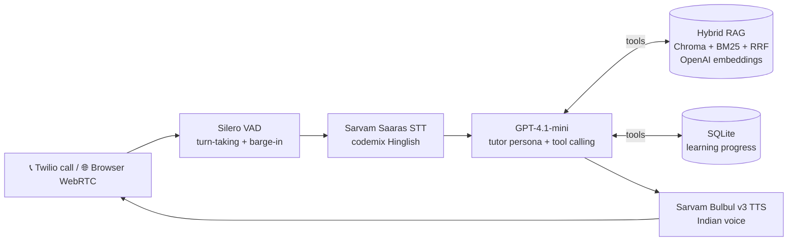

# 🎓 Kalam Didi — Voice-First AI Tutor (Hinglish, NCERT-grounded)

A student **calls a phone number** (or opens a browser link), asks a doubt in Hindi / English / Hinglish,
and gets a patient tutor that explains with Indian analogies, grounded in **NCERT Class 10 Science & Maths**,
checks understanding, quizzes them, and remembers what they studied last time.

Built for the **SuperKalam — AI Applied Engineer (Voice First)** application.

> **New:** A custom browser frontend lives in [`frontend/index.html`](frontend/index.html) — open it after `python bot.py` is running for a fully themed voice UI.



## ✨ What it does
| | |
|---|---|
| 🗣️ **Natural Hinglish voice** | Sarvam STT in `codemix` mode + Bulbul v3 Indian voice. LLM writes Hindi in Devanagari & English terms in Latin → correct pronunciation |
| ✋ **Barge-in** | Student can interrupt mid-answer; TTS stops instantly (Pipecat interruption handling + Silero VAD) |
| 📚 **Grounded answers** | Every syllabus fact comes from `search_knowledge_base` over 27 NCERT chapters (1,205 chunks) |
| 🔍 **Hybrid retrieval** | Semantic (OpenAI text-embedding-3-small, Chroma) + keyword (BM25) fused with Reciprocal Rank Fusion, subject metadata filter |
| 🧠 **Socratic tutor flow** | greet → understand → search → explain w/ analogy → check "समझ आया?" → follow-up → quiz → wrap-up |
| 📝 **Quiz mode** | `generate_quiz_question(topic, difficulty)` grounded in NCERT text |
| 💾 **Memory** | Progress saved per caller number; next call: "पिछली बार हमने light पढ़ा था!" |
| ⏱️ **Latency hiding** | Spoken filler ("एक second, मैं book में देखती हूँ") while RAG runs |
| 📞 **Hangs up itself** | `end_session` tool speaks goodbye and ends the call |
| 📊 **Session analytics** | Full transcript incl. tool calls saved to `sessions/*.json` |

## 📈 Results
| Metric | Result |
|---|---|
| Retrieval Hit@3 on 24 real-style queries (EN / Hinglish / Hindi) | run `pytest -s tests/test_rag.py` (96 % with the earlier local e5 model) |
| Knowledge base | 27 NCERT chapters → 1,205 chunks |
| Core code (bot + agent + RAG) | ~330 lines of Python |

## 🚀 Quick start
> **Requires Python 3.11+** (macOS system Python is 3.9 → `brew install python@3.12`)

```bash
python3.12 -m venv .venv && source .venv/bin/activate
pip install -U pip
pip install -r requirements.txt
cp .env.example .env            # add OPENAI_API_KEY + SARVAM_API_KEY

python scripts/download_ncert.py   # 27 official NCERT PDFs
python scripts/ingest.py           # build index (~1 min, ≈ ₹1 of OpenAI embeddings)
python scripts/ingest.py "photosynthesis kaise hota hai"   # try a search
pytest -q -s                       # tests + retrieval eval

python scripts/chat.py             # text-mode tutor (debug agent logic, no voice)
python bot.py                      # 🎙️ voice tutor → open http://localhost:7860
```

### 🌐 Custom frontend
After the bot server is running, open the themed frontend directly in your browser:

```bash
open frontend/index.html          # macOS
# or serve it locally alongside the bot:
python -m http.server 3000 --directory frontend
# then visit http://localhost:3000
```

The frontend connects to `http://localhost:7860` by default. You can change the server
URL using the input field in the top-right corner.

> **Note:** Browser opens the file directly (`file://`) so point it at the running bot.
> There is no CORS issue because the bot server allows all origins by default.

Phone calls: see [SETUP.md](SETUP.md) (ngrok + Twilio, ~10 min).

## 🗂️ Structure
```
bot.py                  Pipecat voice pipeline (WebRTC + Twilio from the same code)
frontend/index.html     Custom browser UI — themed voice interface (mic, waveform, status)
tutor/prompts.py        Tutor persona, voice rules, teaching flow
tutor/tools.py          5 agent tools (search, quiz, save/get progress, end call)
tutor/rag.py            PDF → chunks → OpenAI embeddings → Chroma + BM25 hybrid search
scripts/                download_ncert.py, ingest.py, chat.py (text REPL)
tests/                  RAG eval (Hit@3), tool tests
demo/                   Loom script, outreach templates, sample session
```

### Frontend features
| | |
|---|---|
| 🎙️ **Animated orb** | Pulsing ripple rings while listening; colour shifts when bot is speaking |
| 📊 **Live waveform** | Real-time mic + bot audio drawn on a `<canvas>` (Web Audio API) |
| 🌗 **Dark / light** | Respects system preference; toggle button in header |
| 📡 **Configurable server** | Bot URL editable in header — no code change needed |
| ⏱️ **Session timer** | Live clock + input-level meter + mode display |
| 📝 **Transcript log** | Connection events shown inline |

## 🧩 Design decisions
- **Pipecat over hand-rolled websockets**: VAD, barge-in, resampling (8 kHz μ-law ↔ 16/24 kHz) and transport
  switching come for free, so the effort goes into the tutoring experience.
- **Single agent + tools instead of a rigid state graph**: the tutoring stages live in the prompt and the LLM moves
  between them naturally (students jump around!). One LLM hop per turn = lower latency than a multi-node graph.
- **Sarvam for Indian speech**: best Hinglish recognition and most natural Indian voices; `codemix` STT output keeps
  English science terms in English, which also improves retrieval.
- **OpenAI embeddings + BM25**: no local model/torch (light Docker image, fast startup), multilingual embeddings handle Hinglish paraphrases; BM25 nails exact terms like "Ohm's law", "AP", "HCF".
- **Short, spoken-style answers**: ≤60 words per turn, formulas read out in words, check-question at the end.

## 🛣️ Next steps
Cross-encoder re-ranking · per-student difficulty adaptation · Exotel/Plivo Indian number (Pipecat supports
`-t exotel` / `-t plivo` with the same bot) · fine-tuned Hinglish voice · latency dashboard from Pipecat metrics.
